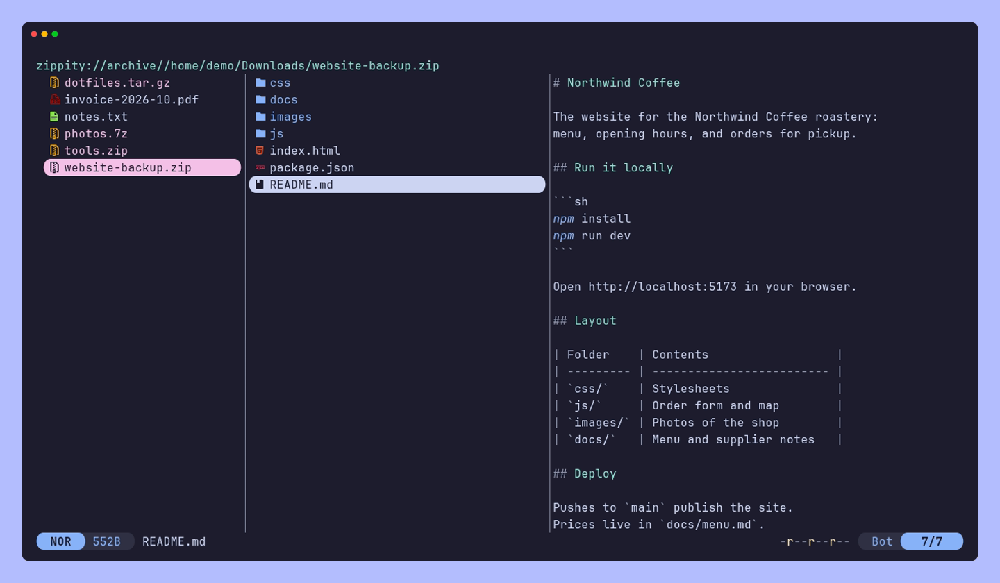
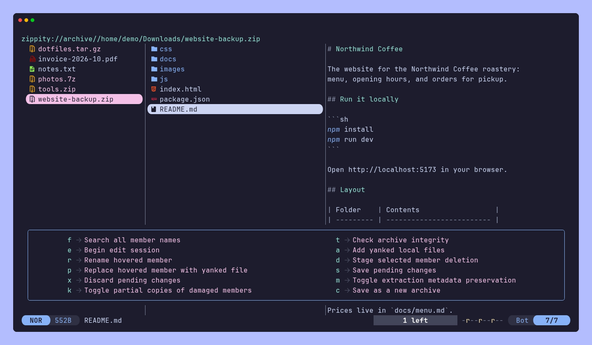
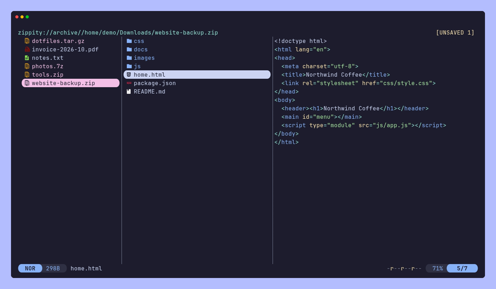

# zippity

Zippity lets you browse and manage archives in [Yazi](https://github.com/sxyazi/yazi)
on Linux and macOS. You enter an archive like a folder, search member names, preview
files, and extract a selection without unpacking the rest.

It pairs a Lua plugin for Yazi with a Rust helper. The helper reads and writes archives
through the official [7-Zip](https://www.7-zip.org/) `7zz` executable, and writes RAR
archives through [RARLAB `rar`](https://www.rarlab.com/download.htm) if you install it.



## Contents

- [Formats](#formats)
- [Requirements](#requirements)
  - [macOS](#macos)
  - [Arch Linux](#arch-linux)
  - [Debian](#debian)
  - [Other Linux distributions](#other-linux-distributions)
  - [RAR writer](#rar-writer)
- [Install](#install)
  - [From a release](#from-a-release)
  - [From source](#from-source)
  - [Plugin with ya pkg](#plugin-with-ya-pkg)
  - [Configure Yazi](#configure-yazi)
- [Keys](#keys)
- [Extracting](#extracting)
  - [Damaged archives](#damaged-archives)
  - [Multipart archives](#multipart-archives)
  - [Permissions and times](#permissions-and-times)
  - [Symbolic links](#symbolic-links)
- [Previews and large files](#previews-and-large-files)
- [Editing archives](#editing-archives)
- [Creating archives](#creating-archives)
- [Save As](#save-as)
- [Finder tags and icons](#finder-tags-and-icons)
- [Passwords and private data](#passwords-and-private-data)
- [Limits](#limits)
- [Development](#development)
- [License](#license)

## Formats

| What you can do | Formats |
| --- | --- |
| Browse, search, preview, extract, and verify | ZIP, RAR, 7z, ISO 9660 and UDF images, and tar, plain or compressed with gzip, bzip2, xz, zstd, lzma, compress (`.Z`), or lz4 |
| Open as a one-member archive | gz, bz2, xz, zst, lzma, Z, and lz4 files |
| Browse, preview, extract, and verify, read-only | ar and deb, arj, cab, chm, cpio, lzh, msi, xar and pkg, rpm, wim, exe installers, squashfs, cramfs, dmg, ext, FAT, NTFS, HFS+, APFS, GPT disks, qcow2, VDI, VHD, VHDX, VMDK, and Android sparse images |
| The same through [`unar`](https://theunarchiver.com/command-line), read-only | StuffIt (sit, sitx, sea) and Amiga LZX |
| Open nested archives | Any format above, up to eight levels deep |
| Add, delete, rename, and replace members | Single-volume ZIP, 7z, and RAR (with `rar`) |
| Create with compression settings, encryption, and split volumes | ZIP, 7z, and RAR (with `rar`) |
| Save as another format or with another password | Any readable format, into ZIP, 7z, or RAR (with `rar`) |
| Keep [Finder](https://support.apple.com/guide/mac-help/get-to-know-the-finder-on-your-mac-mchlp2605/mac) tags, label colors, and custom file icons | On macOS, in the layout Finder uses |

Zippity recognizes archives by their content, so a ZIP named `backup.bin` opens, and so
do ZIP-based files such as jar, apk, cbz, and epub. A disk image opens at the file system
inside it, which 7zz reaches through the partition table without copying anything out.
A deb opens at its own level, with its control and data parts as nested archives.

A compressed file that holds a tar opens as that tar. Any other compressed file opens as
an archive with one member, the decompressed file. bzip2, `.Z`, lzma, lz4, and some zstd
files don't record the decompressed size, so Zippity shows that member as 0 bytes and
asks before previewing it. Paste extracts it, up to the free space at the destination.

Browsing never changes an archive. Changes need an edit session and a save, and Discard
leaves the source as it was. Nested archives, existing split sets, and disc images stay
read-only. Zippity reads ISO 9660, Joliet, and UDF images through 7zz without mounting
them. Integrity checks (Alt-t) use the checks each format already has, such as stored
CRCs, and add no checksums of their own.

## Requirements

- [Yazi](https://yazi-rs.github.io/docs/installation) 26.9.1. Its custom filesystem API is
  experimental, so other versions need testing first.
- The official 7-Zip `7zz` on PATH. The test suite runs against 7-Zip 26.05.
- Yazi's usual [preview tools](https://yazi-rs.github.io/docs/installation) for the file
  types you view.
- [Rust](https://www.rust-lang.org/tools/install) stable, if you build the helper from source.

Optional tools add formats and RAR writing:

- RARLAB `rar` creates and edits RAR archives. See [RAR writer](#rar-writer).
- [`lz4`](https://github.com/lz4/lz4) opens lz4 files, which 7zz doesn't read.
- `unar` and `lsar` from [The Unarchiver](https://theunarchiver.com/command-line) open
  StuffIt and Amiga LZX archives. unar takes passwords only as command-line arguments, so
  Zippity refuses encrypted ones.

Zippity runs only a program named `7zz`. It doesn't support
[p7zip](https://p7zip.sourceforge.net/) or run on Windows.

### macOS

Install Yazi and 7-Zip with [Homebrew](https://brew.sh/):

```sh
brew install yazi sevenzip
```

Add the optional tools:

```sh
brew install lz4 unar
```

### Arch Linux

```sh
sudo pacman -S --needed yazi 7zip
```

Arch's [`7zip`](https://archlinux.org/packages/extra/x86_64/7zip/) package installs
official 7-Zip as `7z`. Link it as `7zz`:

```sh
mkdir -p "$HOME/.local/bin"
ln -s "$(command -v 7z)" "$HOME/.local/bin/7zz"
```

Add the optional tools. [`rar`](https://aur.archlinux.org/packages/rar) comes from the AUR,
so it needs an AUR helper such as [yay](https://github.com/Jguer/yay):

```sh
sudo pacman -S --needed lz4 unarchiver
yay -S rar
```

### Debian

Install Yazi from [Yazi's APT repository](https://yazi-rs.github.io/docs/installation#apt).
Debian 13's own [`7zip`](https://packages.debian.org/trixie/7zip) package (25.01) prints a
password prompt that Zippity doesn't recognize, so install the official 7-Zip build:

```sh
mkdir -p "$HOME/.local/bin"
curl -fsSL https://github.com/ip7z/7zip/releases/download/26.05/7z2605-linux-x64.tar.xz | tar -xJ -C "$HOME/.local/bin" 7zz
```

Add the optional tools:

```sh
sudo apt install lz4 unar
```

Debian ships [`rar`](https://packages.debian.org/trixie/rar) in its non-free component.
[Enable non-free](https://wiki.debian.org/SourcesList), then:

```sh
sudo apt install rar
```

### Other Linux distributions

Use the official 7-Zip build from the [Debian](#debian) section, or another
[official 7-Zip download](https://www.7-zip.org/download.html). Some distribution builds
leave out RAR support, so check that 7zz lists both Rar and Rar5:

```sh
7zz i | grep -E -w 'Rar5?'
```

### RAR writer

Install the [RARLAB command-line release](https://www.rarlab.com/download.htm) yourself
and put `rar` on PATH. Its [license](https://www.rarlab.com/license.htm) has
evaluation-period and paid-use terms. Zippity doesn't bundle RARLAB binaries or licensing
material, and its own MIT license stays as it is.

The Arch and Debian sections above install `rar`. Homebrew disabled its `rar` cask, so on
macOS take RARLAB's build for Apple Silicon:

```sh
mkdir -p "$HOME/.local/bin"
curl -fsSL https://www.rarlab.com/rar/rarmacos-arm-723.tar.gz | tar -xz -C /tmp
install -m 755 /tmp/rar/rar "$HOME/.local/bin/rar"
```

Without `rar`, you can still browse, preview, extract, and verify RAR archives. Creating
and editing them needs `rar`.

## Install

### From a release

Each [release](https://github.com/hawkff/zippity/releases) has a bundle for macOS on
Apple Silicon and one for Linux on x86_64, whose helper is a static binary that runs on
any distribution. A bundle holds the helper, the plugin, the example configuration, and
an `INSTALL.md`.

Download your bundle and `SHA256SUMS` into one folder, then check the download. On macOS,
use [`shasum`](https://perldoc.perl.org/shasum):

```sh
shasum -a256 -c --ignore-missing SHA256SUMS
```

On Linux, use [`sha256sum`](https://www.gnu.org/software/coreutils/manual/html_node/sha2-utilities.html):

```sh
sha256sum -c --ignore-missing SHA256SUMS
```

Extract the bundle and install the helper and the plugin:

```sh
tar -xzf zippity-v*.tar.gz && cd zippity-v*/
mkdir -p "$HOME/.local/bin"
install -m 755 bin/zippity "$HOME/.local/bin/zippity"
config="${YAZI_CONFIG_HOME:-${XDG_CONFIG_HOME:-$HOME/.config}/yazi}"
mkdir -p "$config/plugins/zippity.yazi"
cp -R zippity.yazi/. "$config/plugins/zippity.yazi/"
```

Keep `$HOME/.local/bin` on PATH. The macOS binary has an ad-hoc signature and isn't
notarized. If you downloaded the bundle in a browser, macOS quarantines the helper and
[Gatekeeper](https://support.apple.com/guide/security/gatekeeper-and-runtime-protection-sec5599b66df/web)
refuses to run it. Clear the flag with [`xattr`](https://ss64.com/mac/xattr.html):

```sh
xattr -dr com.apple.quarantine "$HOME/.local/bin/zippity"
```

### From source

```sh
git clone https://github.com/hawkff/zippity.git && cd zippity
cargo install --path . --locked
config="${YAZI_CONFIG_HOME:-${XDG_CONFIG_HOME:-$HOME/.config}/yazi}"
mkdir -p "$config/plugins/zippity.yazi"
cp -R zippity.yazi/. "$config/plugins/zippity.yazi/"
```

### Plugin with ya pkg

Yazi's [package manager](https://yazi-rs.github.io/docs/cli#pm) installs the plugin:

```sh
ya pkg add hawkff/zippity:zippity
```

Install the helper from a release bundle or from source as above. `ya pkg upgrade` takes
the plugin from `main`. If Zippity then reports an older helper, install the helper from
the newest release.

### Configure Yazi

Merge the examples into your Yazi configuration and keep your existing rules and
bindings:

- [`examples/vfs.toml`](examples/vfs.toml) registers the archive filesystem.
- [`examples/yazi.toml`](examples/yazi.toml) lets Zippity detect and preview archive members.
- [`examples/keymap.toml`](examples/keymap.toml) adds the [keys](#keys).

Restart Yazi afterwards. Install the helper and the plugin from the same release or
commit. The plugin sends requests that older helpers reject, and it tells you when the
helper on PATH is too old. Zippity has no other interface and no system-wide service.

## Keys

| Key | Action |
| --- | --- |
| `l` or Right | Enter a folder or an archive. Open a nested archive, or preview any other member. |
| `h` or Left | Leave a folder, or return from a nested archive. |
| `L` | Inside an archive, turn automatic previews on or off. Elsewhere, go forward in Yazi's history. |
| Alt-p | Preview the hovered member. A nested archive previews as its listing. |
| Alt-f | Search member paths across the whole archive. |
| Alt-t | Verify the archive's integrity. |
| Alt-a | Open the archive actions menu. |
| `y`, then `p` | Extract the copied members into the current local folder without overwriting anything. |
| `P` | Extract and overwrite, replacing each destination only after its member decodes. |
| Alt-x | Extract each selected archive, or the hovered one, beside itself. |
| Alt-n | Create an archive from the selection. |
| Alt-z | Compress the selection at once with the last settings. |
| Alt-e, Alt-s, Alt-d | Start an edit session, save it, or discard it. |
| Alt-u | Set or replace the archive's password. On a member, set that member's password. |
| Alt-l | Lock the archive, which forgets its passwords and removes Zippity's caches for it and its nested views. |
| `x` | Cut, outside archives only. |
| `q` | Close edit sessions, clean caches, and quit. Quitting inside an archive leaves your shell's directory unchanged. |
| `Q` | Close edit sessions, clean caches, and quit without changing your shell's directory. |

Alt-a opens the archive actions menu:



## Extracting

Copy members with `y` and press `p` in a local folder. `p` keeps existing files. `P`
overwrites, and replaces each destination only after its member decoded and passed its
checks.

Alt-x extracts whole archives. Select archives, or hover one, and press Alt-x. Each
archive extracts beside itself, wherever you are in Yazi. If an archive has one top-level
member, Alt-x puts that member beside the archive. If it has several, Alt-x puts them in
a new folder named after the archive, such as `photos` for `photos.zip`. Alt-x never
replaces existing files. If a target name exists, it adds `_1`, `_2`, and so on.

Outside archives, `p`, `P`, and `x` act on ordinary files as they do in Yazi. Copy
archive members and ordinary files separately. Zippity extracts only into local folders,
and `x` refuses archive members.

### Damaged archives

If a member fails to decode, paste and Alt-x still extract the others. Zippity checks
what a failed pass wrote against the CRCs in the archive listing instead of decoding it
again. A damaged solid 7z or RAR stream therefore takes a few extra passes rather than
one per member. The report names the damaged members, and separately the members lost to
damage earlier in their stream. Members without a CRC, as in tar and ISO images, count
only after a pass that finished without errors. If 7zz fails for the whole archive, as
when it runs out of memory, you get that error instead.

The archive actions menu (Alt-a) has an option to keep what 7zz produced for each
damaged member as `<name>.damaged` beside the extracted files. The option is off by
default. These partial copies are private and unverified, and they never replace an
existing file.

### Multipart archives

Keep all volumes of a multipart archive in one folder. Zippity opens these sets:

- RAR sets named `.part01.rar` and up, or `.rar` with `.r00` and up.
- Numbered `.001` sets that 7zz writes.
- [Info-ZIP](https://infozip.sourceforge.net/) spanned sets (`.z01`, `.z02`, and so on, with the last part named `.zip`), from any segment.

A missing or ambiguous volume stops with an error.

### Permissions and times

By default, extracted files get private permissions and the time you extracted them. The
metadata action in the archive actions menu (Alt-a) restores ordinary permission bits and
modification times instead. Zippity never restores ownership, setuid or setgid bits, or
special files. With restoring off, an overwritten file keeps its ordinary access bits.
Preview caches stay private either way.

### Symbolic links

Zippity lists a symbolic link when its target stays inside the archive, and extracts it
as a link when the target also stays inside the destination folder. It leaves out any
other link and reports it. [Limits](#limits) lists what else stays hidden.

## Previews and large files

Browsing reads only the archive's listing. Alt-p, or `l` on a file, copies that one
member to a private cache and previews it. Zippity asks first for members larger than
32 MiB. Opening a nested archive copies only that inner archive out, then browses it the
same way.

Press `L` inside an archive to preview each member as you hover it. Zippity copies only
the hovered member. Members over 32 MiB still need Alt-p or `l`, and a locked member
needs its password from Alt-u first. Press `L` again to stop. Cached previews stay until
Lock (Alt-l) or quit, which also turn automatic previews off. Each nested archive has its
own toggle.

The member cache also keeps the archive's listing, so later previews and extractions in
an unchanged archive skip listing it again.

Tar archives stream through the decompressor and tar reader, so they need no unpacked
copy. To reach a member of a solid 7z or RAR archive or a compressed tar, Zippity may
still have to decode the data before it. Paste lists each archive once and decodes all of
its selected members in one pass, though a selection of thousands of members can take a
few passes.

If Yazi reads a member directly, Zippity starts a private reader for that archive. The
reader keeps its decoder open for sequential reads, uses bounded buffers, and restarts
decoding after a backward seek or a switch to another member. It exits with Yazi, when
its cache goes away, or after a while without reads. It isn't a system-wide service, and
it keeps no passwords on disk.

A streaming decoder may report an integrity failure only at the end of a read. Use the
paste keys when a failed extraction must leave the destination alone. They verify a
temporary copy before they replace anything.

## Editing archives

Open a single-volume ZIP, 7z, or RAR archive and press Alt-e to start an edit session.
The header shows `[EDIT]`, then `[UNSAVED n]` once you stage changes. Stage them from the
archive actions menu (Alt-a):

| Change | How |
| --- | --- |
| Add | Yank local files or folders, return to the archive, and choose Add. Pasting into the archive during an edit session also stages them in the current folder. |
| Delete | Select members and choose Delete. |
| Rename | Hover a member, choose Rename, and enter its new path in the archive. |
| Replace | Yank one local file, hover a member, and choose Replace. |



Alt-s saves and Alt-d discards. Closing or locking an archive with unsaved changes asks
whether to save, discard, or cancel. Staged changes don't survive a crash, so keep the
files you added until the save finishes.

A save works on a private copy of the archive. Zippity checks the new archive and its
member list before it replaces the original. If the archive or a file you added changed
after you staged it, the save fails and leaves the newer data in place. Only one Zippity
save at a time can run on an archive.

Saving an encrypted archive needs one password that opens it, and the save keeps the
archive's encryption. Zippity reads archives whose members use different passwords, but
you may need another tool to edit them.

## Creating archives

Select local files or folders and press Alt-n. Choose ZIP, 7z, or RAR, then enter the
destination, compression, encryption, and volume size.

- Compression levels are `0`, `1`, `3`, `5`, `7`, and `9`. RAR maps them to its six levels.
- After the level you can add `method=`, `dict=`, `word=`, and `solid=`, as in
  `9 method=PPMd dict=256m word=16 solid=off`. 7z takes LZMA2, LZMA, PPMd, BZip2,
  Deflate, Deflate64, or Copy, and ZIP takes the same except LZMA2. `dict=` sets the
  dictionary size, or PPMd's model memory. `word=` sets the fast bytes for LZMA and
  Deflate, or PPMd's model order. `solid=` takes on, off, or a block size for 7z. RAR
  takes only `dict=` and `solid=on` or `off`. The dialog offers each format's last
  settings again until Yazi restarts.
- ZIP encrypts with AES-256 or the older ZipCrypto. 7z and RAR use their own encryption
  and can also encrypt file names, which ZIP can't.
- A volume size of 0 creates one file. Split volumes must be at least 1 MiB.

Alt-z skips the dialog. It uses the format and compression you chose last, ZIP at level 5
until then, and no password. One item gets an archive beside it, and several items get
one in the current folder. The name follows the selection, as in `notes.txt.zip`,
`photos.zip`, or `archive.zip` for several items. If that name exists, Zippity adds
`_1`, `_2`, and so on.

Zippity copies the inputs to private staging, writes the archive there, and checks it
before publishing it. It refuses an existing destination and a destination inside a
selected folder. A split set appears as a new folder, such as `backup.7z.parts` holding
`backup.7z.001`, `backup.7z.002`, and so on, once the whole set passes its check. Zippity
never overwrites an existing volume set.

Inside selected folders, Zippity leaves out Finder's `.DS_Store` files, `Icon\r` folder
icon files, and `._*` AppleDouble files. A file with such a name that you select directly
still goes in.

Zippity stores symbolic links as links. It stores a link whose target leaves the
selection too, and the archive's listing hides it like any such link. An edit session
adds only links whose targets stay inside the archive.

## Save As

"Save as a new archive" in the archive actions menu (Alt-a) writes every member of the
open or hovered archive into a new archive through the creation dialog. It converts any
readable format, such as RAR, an ISO image, or StuffIt, into ZIP, 7z, or RAR, and it can
add, change, or remove the password. Saving an encrypted archive without a password asks
you first. The source archive stays as it is.

The destination defaults to the source's folder and name with the new extension, plus
`-copy` when that path would be the source itself. Zippity copies the members out with
their modification times and permissions into private staging beside the destination,
checks them, and removes the staging afterwards. Finder metadata, such as `.DS_Store`
members and `__MACOSX` entries, comes along, and so do links. Save As refuses archives
with hidden members, nested archives, and archives with unsaved edits.

## Finder tags and icons

7-Zip doesn't read extended attributes, so Zippity carries Finder metadata itself. It
uses the AppleDouble layout that Finder and
[Archive Utility](https://en.wikipedia.org/wiki/Archive_Utility) use, with one
`__MACOSX/<folder>/._<name>` entry per item.

- On macOS, creating an archive, Alt-z, and additions in an edit session store Finder
  tags, label colors, and custom file icons. Other attributes, such as quarantine flags
  and download addresses, stay out.
- On macOS, extraction applies them to the extracted files and folders, including from
  archives that Finder made.
- On every platform, listings hide `__MACOSX` and the `._name` files beside their
  members. Extraction doesn't write them as files, and edits keep them with their members.
- Zippity doesn't keep custom folder icons. Finder stores them in an `Icon\r` file, which
  creation leaves out.

## Passwords and private data

Passwords stay in memory and reach the helper through stdin or a private local socket.
They never go into command-line arguments, environment variables, configuration, or
input history. You type a new archive password twice.

Lock (Alt-l) and quit remove Zippity's caches. If cleanup fails, Zippity tells you and
still lets you quit. Yazi's previewers and external viewers may keep caches of their own.
Listings that need a password never go into the member cache.

A crash or a forced exit can leave private cache folders or `.zippity-*` partial files
behind. Each cache folder contains a `.zippity-cache` marker. Remove one with:

```sh
zippity --clean-cache /path/to/zippity-cache-directory
```

The command removes only marked, private folders directly inside the temporary folder.
Removing files doesn't securely erase them from disk.

## Limits

- Listings hide hard links, links whose targets leave the archive, special files,
  alternate streams, and names with unsafe paths or control characters. Zippity reports
  how many it hid, never extracts them, and doesn't edit archives that have any.
- 7zz prints a newline in a member name as `_`, so such a member shows that way, and
  Zippity can't extract it.
- Zippity doesn't support archives with duplicate paths or multiline comments.
- An index holds at most 200,000 entries, 16 MiB of paths, and 64 MiB of listing output.
- An edit session holds at most 10,000 changes. A large save needs disk space for a copy
  of the archive and the staged inputs.
- Zippity refuses RAR edits that involve names that look like wildcards, so that `rar`
  can't change other members.
- A listing gets 60 seconds. An extraction gets one hour plus one second for each MiB it
  writes. Compressed-tar traversal and writes get one hour.
- The one-shot read command reads members up to 32 MiB. The private reader handles
  larger reads.
- You can't edit existing split sets or nested archives in place. Extract them to a
  standalone archive first.
- Some actions take several passes over the archive, so large edit batches and random
  seeks in solid archives can be slow.

## Development

Run `bash scripts/check.sh` with Rust, 7zz, Yazi 26.9.1,
[`file`](https://www.darwinsys.com/file/), [Lua](https://www.lua.org/),
[Python 3](https://www.python.org/), [tmux](https://github.com/tmux/tmux), and
[zstd](https://github.com/facebook/zstd) on PATH. Package and image fixtures use their own
tools when present: [dpkg-deb](https://manpages.debian.org/trixie/dpkg/dpkg-deb.1.en.html),
[arj](https://arj.sourceforge.net/), [gcab](https://gitlab.gnome.org/GNOME/gcab),
[cpio](https://www.gnu.org/software/cpio/), [makensis](https://nsis.sourceforge.io/),
[rpmbuild](https://rpm.org/), [wimlib-imagex](https://wimlib.net/),
[mksquashfs](https://github.com/plougher/squashfs-tools),
[mkfs.cramfs](https://github.com/util-linux/util-linux),
[mke2fs](https://e2fsprogs.sourceforge.net/),
[mkfs.vfat](https://github.com/dosfstools/dosfstools) with
[mtools](https://www.gnu.org/software/mtools/), mkntfs with ntfscp from
[ntfs-3g](https://github.com/tuxera/ntfs-3g), [sfdisk](https://github.com/util-linux/util-linux),
[qemu-img](https://www.qemu.org/docs/master/tools/qemu-img.html),
[img2simg](https://android.googlesource.com/platform/system/core/+/refs/heads/main/libsparse/),
lz4, [compress](https://github.com/vapier/ncompress),
[zip](https://infozip.sourceforge.net/Zip.html), and unar, plus
[hdiutil](https://ss64.com/mac/hdiutil.html),
[xar](https://github.com/apple-oss-distributions/xar), and
[pkgbuild](https://keith.github.io/xcode-man-pages/pkgbuild.1.html) on macOS. The suite
tests the RAR writer when a licensed or evaluation `rar` is on PATH.

Install them on Debian 13:

```sh
sudo apt install file lua5.4 python3 tmux zstd arj gcab cpio nsis rpm wimtools squashfs-tools \
  util-linux-extra e2fsprogs dosfstools mtools ntfs-3g fdisk qemu-utils \
  android-sdk-libsparse-utils lz4 ncompress zip unar
```

On Arch Linux:

```sh
sudo pacman -S --needed file lua python tmux zstd dpkg arj gcab cpio rpm-tools wimlib \
  squashfs-tools util-linux e2fsprogs dosfstools mtools ntfsprogs qemu-img android-tools \
  lz4 ncompress zip unarchiver
yay -S nsis
```

macOS has `file`, hdiutil, xar, and pkgbuild, and the Xcode Command Line Tools add
Python 3. Add the rest with Homebrew:

```sh
brew install lua tmux zstd lz4 unar
```

The suite covers the Rust backend, filesystem safety, formats, encryption, split sets,
staged saves, cancellation, the native reader, and the Yazi workflow itself.

It ends with `tests/bench.py` on a release build. The benchmark compares the helper with
7zz doing the same work, on archives of up to 199,000 files. It times listing, previews,
extraction, integrity checks, and nested archives, plus opening an archive and Alt-x in
Yazi. With `ZIPPITY_BENCH_BUDGET=1` it fails when the helper goes over its budget.
Timings vary with machine load, so that check is opt-in.

## License

MIT. See [LICENSE](LICENSE). The RAR test fixtures keep
[libarchive's license](tests/fixtures/COPYING). External archive tools have their own
licenses.
